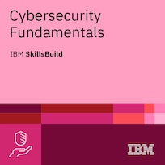

# Máximo Sánchez Fernández

  

## `About me`

💻 Student of **Administración de Sistemas Informáticos en Red (ASIR)**.

🔐 Interested in cybersecurity, Linux administration, networking and automation.

🛠️ I enjoy building projects, experimenting with systems and learning through hands-on practice.

🎯 My goal is to develop my skills in system administration and cybersecurity.

 ## `💻 Languages & Scripting`

  
  
  
  
  
  
  
  

## `🐧 Systems & Tools`

  
  
  
  
  
  
  
  
  
  
  
  
  

## `🌐 Networking & Cybersecurity`

  
  
  
  
  
  
  
  
  
  
  
  

## `🏆 CERTIFICATIONS`

  

## `🏆 CERTIFICATIONS`

  

<table>
  <!-- PRIMERA FILA (4 CERTIFICADOS) -->
  <tr>
    <td align="center" width="25%">
      
       
      <strong>Data Analytics Essentials</strong>
       
      Credencial verificada ✅
       
      <a href="https://www.credly.com/badges/cc17a582-09b8-44a5-aa95-43bfc1656427/public_url">Ver credencial ↗</a>
    </td>
    <td align="center" width="25%">
      
       
      <strong>Networking Basics</strong>
       
      Credencial verificada ✅
       
      <a href="https://www.credly.com/badges/a5a549f8-a3f4-44f7-8c85-fc9c52b24f0f/public_url">Ver credencial ↗</a>
    </td>
    <td align="center" width="25%">
      
       
      <strong>Network Support and Security</strong>
       
      Credencial verificada ✅
       
      <a href="https://www.credly.com/badges/a5c5301a-b625-4112-a088-adeee7b9d22c/public_url">Ver credencial ↗</a>
    </td>
    <td align="center" width="25%">
      
       
      <strong>Getting Started with Generative AI</strong>
       
      Credencial verificada ✅
       
      <a href="https://www.credly.com/badges/918192bf-6ddf-4dbf-bd46-ca1523366617/public_url">Ver credencial ↗</a>
    </td>
  </tr>
  
  <!-- SEGUNDA FILA (4 CERTIFICADOS) -->
  <tr>
    <td align="center" width="25%">
      
       
      <strong>AI Literacy</strong>
       
      Credencial verificada ✅
       
      <a href="https://www.credly.com/badges/6c005c67-b860-4c22-81b3-a9de13f095a3/public_url">Ver credencial ↗</a>
    </td>
    <td align="center" width="25%">
      
       
      <strong>Artificial Intelligence Fundamentals</strong>
       
      Credencial verificada ✅
       
      <a href="https://www.credly.com/badges/01f6008f-324a-437a-a49e-6e525e77c78e/public_url">Ver credencial ↗</a>
    </td>
    <td align="center" width="25%">
      
       
      <strong>Data Fundamentals</strong>
       
      Credencial verificada ✅
       
      <a href="https://www.credly.com/badges/657b1a5b-07af-4c25-95aa-1e51be7ad1b5/public_url">Ver credencial ↗</a>
    </td>
    <td align="center" width="25%">
      
       
      <strong>Cybersecurity Fundamentals</strong>
       
      Credencial verificada ✅
       
      <a href="https://www.credly.com/badges/ffc4a264-8df8-4b19-84e4-ad95eee1c5b1/public_url">Ver credencial ↗</a>
    </td>
  </tr>
</table>

## 🌊​ Featured Projects

### 🤖 <a href="https://github.com/maximo-sf/My-Projects">My-Projects</a>
Personal projects, automation tools and practical applications.

🔹 Python projects and practical development.

🔹 Minecraft Discord bot for server status and administration.

<strong>Technologies:</strong> Python · Discord.py · Git

 

### 🌐 <a href="https://github.com/maximo-sf/Networking">Networking</a>
Networking labs and system infrastructure exercises.

🔹 DHCP configuration and network services.

🔹 SRI practice and network administration.

🔹 Dns configurator step by step.

<strong>Topics:</strong> Networking · DHCP · Linux · TCP/IP

 

### 💻 <a href="https://github.com/maximo-sf/Programming">Programming</a>
Programming exercises and projects developed while learning.

🔹 Programming fundamentals and practical exercises.

🔹 Small applications and development practice.

<strong>Technologies:</strong> Programming · Scripting

 

<a href="https://github.com/maximo-sf?tab=repositories">View all repositories →</a>

  

> More projects and documentation coming soon.

## `⭐ Github Stats`

  
  

  

## `📬 Contact Me`

  I'm open to opportunities, collaborations and new projects.
   
  Feel free to get in touch!

  

